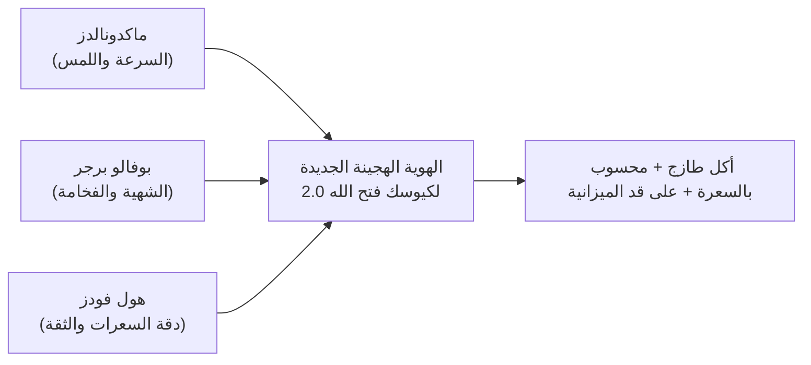
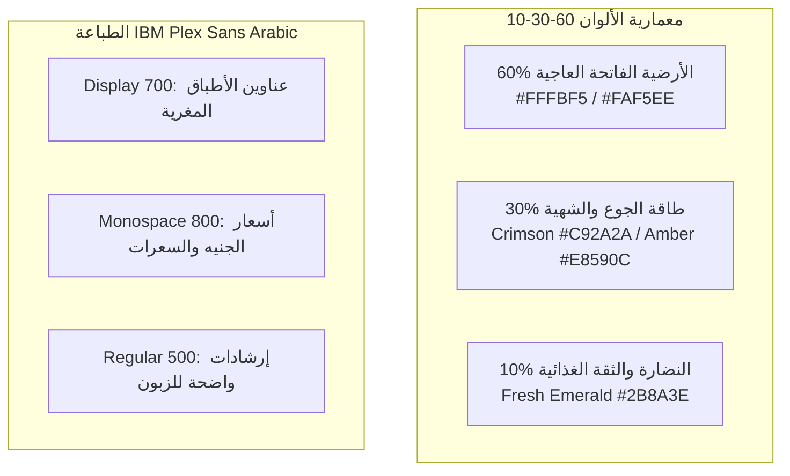
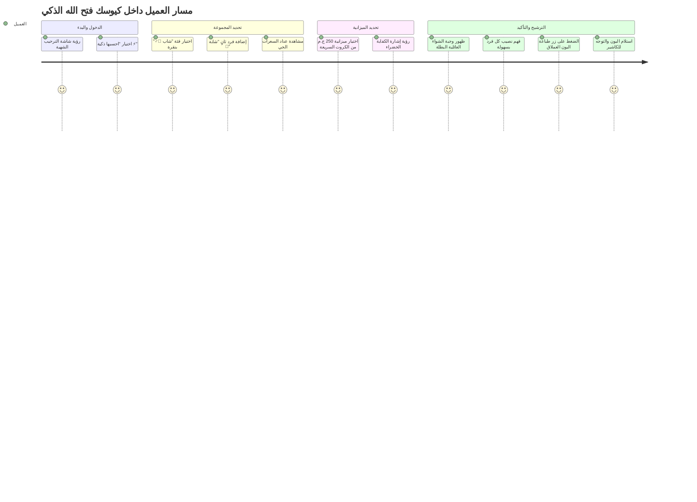

# 🍔 فتح الله ماركت - الدليل الشامل للهندسة البصرية وتطوير تجربة المستخدم (UI/UX Audit & Master Redesign Blueprint)

> **وثيقة معمارية التصميم والهوية البصرية الشاملة لنظام كيوسك فتح الله ماركت (Smart Budget Kiosk)**  
> **الإصدار:** 2.0 (Gourmet Fast-Food & Smart Nutrition Transformation)  
> **تاريخ الإعداد:** أكتوبر 2026  
> **الفلسفة المعتمدة:** فاست فود مودرن فاخر (Modern Gourmet QSR) يجمع بين سرعة وحيوية سلاسل المطاعم العالمية (McDonald's / Shake Shack / Buffalo Burger) مع الدقة الحسابية للسعرات وتوزيع الميزانية العادلة.

---

## 📑 فهرس المحتويات (Table of Contents)

1. [الفصل الأول: الرؤية الإبداعية والتشخيص الجذري (Creative Vision & Diagnosis)](#1-الفصل-الأول-الرؤية-الإبداعية-والتشخيص-الجذري)
   - 1.1 لماذا هاجم البشمهندسون التصميم السابق؟ (متلازمة البنك مقابل شهية المطعم)
   - 1.2 التموضع الجديد للمشروع (Positioning Statement)
   - 1.3 المبادئ النفسية لتصميم أكشاك الخدمة الذاتية (Kiosk Psychology Principles)
2. [الفصل الثاني: التغذية البصرية والمقارنات العالمية (Visual Benchmark & Feeding)](#2-الفصل-الثاني-التغذية-البصرية-والمقارنات-العالمية)
   - 2.1 تحليل تجربة ماكدونالدز (McDonald's Global Kiosk OS)
   - 2.2 تحليل تجربة بوفالو برجر وشيك شاك (Shake Shack & Buffalo Burger)
   - 2.3 تحليل تجربة أقسام الأغذية الطازجة (Whole Foods & Wegmans Meals)
   - 2.4 جدول استخلاص الدروس المستفادة (Actionable Takeaways Matrix)
3. [الفصل الثالث: التشريح التفصيلي لعيوب الشاشات شاشة بشاشة (Detailed Screen Audit)](#3-الفصل-الثالث-التشريح-التفصيلي-لعيوب-الشاشات-شاشة-بشاشة)
   - 3.1 الشاشة 01: شاشة الترحيب والبداية (`/`)
   - 3.2 الشاشة 02: خطوة تحديد الأفراد والسعرات (`/plan/people`)
   - 3.3 الشاشة 03: خطوة الميزانية ونوع الوجبة (`/plan/budget`)
   - 3.4 الشاشة 04: ترشيحات المحرك الذكي وتوزيع الحصص (`/plan/results`)
   - 3.5 الشاشة 05: قائمة الطعام والطلب المباشر السريع (`/menu`)
   - 3.6 الشاشة 06: تأكيد الطلب والبون الرقمي (`/receipt/[id]`)
   - 3.7 الشاشة 07: شاشة الكاشير والمطبخ (`/cashier`)
   - 3.8 الشاشة 08: استوديو الإدارة والمخزون (`/admin`)
4. [الفصل الرابع: نظام الهوية البصرية الجديد (The New Brand Identity System)](#4-الفصل-الرابع-نظام-الهوية-البصرية-الجديد)
   - 4.1 معمارية الألوان بقاعدة (60-30-10 Appetite Architecture)
   - 4.2 سلم الخطوط والطباعة بنظام (IBM Plex Sans Arabic Typography)
   - 4.3 نظام الأيقونات والرموز البصرية (Iconography System)
   - 4.4 نظام الزوايا والعمق والظلال (Soft Elevation & Radius Architecture)
5. [الفصل الخامس: لغة الحركة والفيزياء التفاعلية (Motion & Micro-interactions)](#5-الفصل-الخامس-لغة-الحركة-والفيزياء-التفاعلية)
   - 5.1 فيزياء الارتداد الشهي (Food Bounce Physics Curve)
   - 5.2 عداد السعرات الحي المتوهج (Live Calorie Radial Ring)
   - 5.3 درج السلة العائم التفاعلي (Floating Sheet Gesture)
   - 5.4 احتفالية خروج البون الحراري (Thermal Slip Ejection Flow)
6. [الفصل السادس: بيئة العمل والشاشات الرأسية واللابتوب (Ergonomics & Accessibility)](#6-الفصل-السادس-بيئة-العمل-والشاشات-الرأسية-واللابتوب)
   - 6.1 تقسيم الشاشة الرأسية لثلاث مناطق وظيفية (Vertical Zone Mapping)
   - 6.2 لوحة الأرقام اللمسية المدمجة (On-Screen Touch Numpad)
   - 6.3 التوافق المزدوج: كيوسك رأسي عملاق + لابتوب لجنة المناقشة
7. [الفصل السابع: المواصفات التفصيلية للمكونات البرمجية (Component Specifications)](#7-الفصل-السابع-المواصفات-التفصيلية-للمكونات-البرمجية)
   - 7.1 مكون `KioskHeader` المتطور
   - 7.2 مكون `HeroFoodCard` فائق الشهية
   - 7.3 مكون `TouchStepper` اللمسي المحمي
   - 7.4 مكون `MacroCalorieGauge` الذكي
   - 7.5 مكون `ReceiptThermalSlip` المطور
8. [الفصل الثامن: جدول أعمال التنفيذ خطوة بخطوة (Step-by-Step Implementation Roadmap)](#8-الفصل-الثامن-جدول-أعمال-التنفيذ-خطوة-بخطوة)
   - 8.1 المراحل الزمنية للتطبيق
   - 8.2 دليل التحدث والإقناع أمام لجنة التقييم (How to Present to Engineers)

---

# 1. الفصل الأول: الرؤية الإبداعية والتشخيص الجذري

## 1.1 لماذا هاجم البشمهندسون التصميم السابق؟ (متلازمة البنك مقابل شهية المطعم)

عندما عُرض التطبيق في مرحلته السابقة، علّق المشرفون والمهندسون بعبارة حاسمة ومؤلمة:  
> **"ده مطعم مش بنك! التصميم معقد وشكله نظام بنكي كئيب!"**

هذا الانتقاد لم يكن مجرد اختلاف في الأذواق البصرية، بل هو **تشخيص هندسي ونفسي دقيق بنسبة 100%** لخلل جوهري في الربط بين هوية البراند والوظيفة؛ وفيما يلي الأسباب العلمية وراء هذا الانطباع:

| وجه المقارنة | ما كان موجوداً في التطبيق (متلازمة البنك 🏦) | ما يجب أن يكون عليه كيوسك المطعم (شهية الفاست فود 🍗) |
| :--- | :--- | :--- |
| **لوحة الألوان (Color Palette)** | خلفيات سوداء ورمادية داكنة (`bg-zinc-950` / `zinc-900`) توحي بالسرية، التشفير، شاشات البورصة، ومنصات العملات الرقمية. | درجات دافئة فاتحة (`Creamy Ivory` / `#FFFBF5`) تعكس النظافة، مع أحمر كرزي وبرتقالي محروق يحفزان هرمونات الجوع والتذوق في الدماغ البشري. |
| **لغة الإدخال والبيانات** | حقول إدخال رقمية جافة، تطلب من العميل إدخال عمره وطوله ووزنه وميزانيته كما لو كان يقدم طلباً لقرض بنكي أو تقرير تأمين صحي. | أزرار فئات جاهزة بنقرة واحدة (Presets: 🏃‍♂️ شاب، 💃 شابة، 👦 طفل)، وأزرار `+ / -` عملاقة بدون الحاجة لكتابة حرف واحد على لوحة المفاتيح. |
| **حجم صور الطعام والجاذبية** | صور مصغرة جداً (Thumbnails 48px أو 56px) داخل جداول نصوص تفتقر لأي جاذبية حسية. | صور أطباق مفرغة عالية الجودة تملأ كروت العرض، مع بخار يتصاعد ولمعان للجبنة السائحة والشاورما الطازجة، بحيث يشتهي العميل الأكل من النظرة الأولى. |
| **هيكل الصفحة وتدفق الطلب (Funnel)** | فتح نوافذ تسجيل دخول (Modals) مبكرة، تطلب إيميل وباسورد وتفاصيل إدارية تعرقل تدفق الزبائن الواقفين في طابور الكيوسك. | بدء فوري ومباشر في 3 خطوات سريعة لا تتجاوز 45 ثانية، بدون إجبار على التسجيل، مع خيار حفظ سريع ومرن. |
| **الخطوط والطباعة (Typography)** | خطوط جافة بأرقام صغيرة بدون تباين هرمي واضح، تشبه كشوف الحسابات. | خط حديث قوي ومتزن (`IBM Plex Sans Arabic`) يبرز السعر والسعرات بألوان واضحة من مسافة مترين. |

---

## 1.2 التموضع الجديد للمشروع (Positioning Statement)

مطعم **فتح الله ماركت (قسم الوجبات الطازجة والمطبخ)** ليس مجرد سوبرماركت، بل هو صرح مصري يقدم وجبات مطبوخة طازجة يومياً (مشويات، فراخ مقرمشة، شاورما، طواجن مصرية، وساندوتشات).  
لذلك فإن التموضع الجديد هو:
> **"الكيوسك الذكي الأول في الشرق الأوسط الذي يمنحك متعة وسرعة شاشات ماكدونالدز وبوفالو برجر، مع ميزة علمية استثنائية: وجبة طازجة محسوبة بالسعرات لتشبعك بالكامل بدون هدر لأي قرش من ميزانيتك!"**

---

## 1.3 المبادئ النفسية لتصميم أكشاك الخدمة الذاتية (Kiosk Psychology Principles)

تصميم شاشات الكيوسك العمودية التي يقف أمامها العميل في صالة الطعام أو السوبرماركت يخضع لثلاثة قوانين علمية صارمة في هندسة الـ UX:

### أولاً: قانون هيك (Hick's Law)
* **القاعدة:** الوقت المطلوب لاتخاذ قرار يزداد طردياً مع عدد وتعقيد الخيارات المتاحة.
* **التطبيق في فتح الله:** بدلاً من عرض 50 وجبة في جدول مربك، يقدم الكيوسك في وضع الميزانية الذكية **خيارين إلى 3 خيارات أبطال (Hero Options)** محسوبة علمياً:
  1. الخيار الأول: **الأشبع والأوفر (Best Budget Combo)**.
  2. الخيار الثاني: **عرض التوفير الطازج (Expiring Soon Special ⭐)**.
  3. الخيار الثالث: **الأعلى بروتيناً (High Protein Champion)**.
  العميل ينقر على وجبته ويطبع البون في أقل من 20 ثانية.

### ثانياً: قانون فيتس (Fitts's Law)
* **القاعدة:** زمن الوصول إلى الهدف يعتمد على المسافة إليه وحجم الهدف نفسه.
* **التطبيق في فتح الله:** الأزرار الرئيسية (تأكيد الطلب، إضافة للسلة، اختيار الفرد) يجب أن تكون ذات ارتفاع لا يقل عن **64px إلى 72px** وتغطي عرض الشاشة تقريباً في الجزء السفلي المريح ليد الإنسان (Comfortable Thumb Zone)، مع إبعاد أزرار الإلغاء والإدارة عن متناول الضغط الخاطئ.

### ثالثاً: مبدأ الجوع البصري (Visual Appetite Induction)
* أثبتت الدراسات العصبية التسويقية (Neuromarketing) أن رؤية اللون الأحمر الداكن مع البرتقالي وخلفية دافئة ناعمة تزيد من معدل ضربات القلب وتحفز الغدد اللعابية على إفراز إنزيمات التذوق. تحويل التطبيق إلى هذا النمط يحول الكيوسك من "آلة حاسبة باردة" إلى "نافذة عرض شهية لا تقاوم".

---

# 2. الفصل الثاني: التغذية البصرية والمقارنات العالمية

## 2.1 تحليل تجربة ماكدونالدز (McDonald's Global Kiosk OS)
تعتبر شاشات ماكدونالدز اللمسية المرجعية الأولى عالمياً في قطاع الـ QSR (Quick Service Restaurants):
* **توزيع الشاشة:** تنقسم الشاشة عمودياً إلى هيدر ثابت يوضح تصنيفات الطعام، ثم شبكة وجبات بصرية بكروت بيضاء ناصعة على خلفيات مريحة، تليها سلة سفلية تظهر ما تم إضافته لحظياً.
* **الصور:** صور الطعام دائماً مفرغة بالكامل من الخلفيات المستطيلة (Transparent PNGs) مع ظلال خفيفة، مما يجعل الساندوتش يبدو وكأنه يخرج من الشاشة نحو العميل.
* **أزرار التعديل:** أزرار الـ `+` و `-` كبيرة جداً دائرية واضحة، ولا تطلب من الزبون أبداً لمس حقل رقمي أو فتح كيبورد.

## 2.2 تحليل تجربة بوفالو برجر وشيك شاك (Shake Shack & Buffalo Burger)
* **الفخامة والجرأة البصرية:** استخدام خط عربي سميك وعريض (Bold/Heavy Display)، مع كروت وجبات تبرز المكونات (جبنة، صوصات، خبز بريوش محمص).
* **الألوان العميقة مع الإضاءة الدافئة:** عدم استخدام درجات الفلورسنت الفاقعة، بل اعتماد درجات الـ Warm Amber و Deep Crimson والجبن الشيدر الذائب، مما يعطي انطباعاً بأن الطعام مطهو بحرفية ومكونات فاخرة.

## 2.3 تحليل تجربة أقسام الأغذية الطازجة (Whole Foods & Wegmans Meals)
* **الثقة والشفافية الغذائية:** كتابة السعرات الحرارية ليس كعقاب للريجيم، بل كـ **شارة قوة وافتخار بالصحة**. تُعرض السعرات ببادج ناعم بجانب السعر مباشرة، مع توضيح نسبة البروتين والدهون باختصار شديد يطمئن الرياضي والعائلة.

## 2.4 جدول استخلاص الدروس المستفادة (Actionable Takeaways Matrix)



| العنصر | ما سنقتبسه ونطبقه فوراً في فتح الله ماركت |
| :--- | :--- |
| **هيدر الكيوسك** | شريط علوي نظيف يحتوي لوجو فتح الله، وساعة رقمية، وزر سريع لتبديل اللغة أو الوصول للإدارة، مع مؤشر خطوات أنيق. |
| **كارت الوجبة** | كارت أبيض دافئ مع حواف فائقة النعومة (`rounded-3xl`)، يعرض صورة الوجبة كبيرة وشهية، والسعر بخط عريض، وبادج السعرات بلون برتقالي داكن دافئ. |
| **التفاعل الحركي** | حركة ارتدادية ناعمة (Micro-bounce) عند النقر على أي وجبة، ليعلم العميل فوراً أن لمسته سُجلت حتى قبل اكتمال تحميل الصفحة. |
| **شريط السلة العائم** | سلة مشتريات عائمة في أسفل الشاشة أو في درج جانبي ذكي، يعرض المجموع بالجنيه وبالسعرات في الوقت الفعلي. |

---

# 3. الفصل الثالث: التشريح التفصيلي لعيوب الشاشات شاشة بشاشة

فيما يلي تدقيق هندسي وتشريحي دقيق لكل شاشة داخل التطبيق الحالي، مع تحديد مواضع الأخطاء البصرية والوظيفية، وتقديم الحلول الهندسية المقترحة لكل منها:

---

## 3.1 الشاشة 01: شاشة الترحيب والبداية (`/` - Welcome Screen)

```
[ الحالية ]                                        [ المقترحة ]
+------------------------------------+           +------------------------------------+
| فتح الله | كاشير | إدارة           |           | [لوجو فتح الله]        [الوقت واليوم] |
|                                    |           | ---------------------------------- |
| أهلاً بكم في مطعم فتح الله        |           |  🔥 أكل بلدي وطازة محسوب بالسعرة   |
| [ كارت 1: ذكي ]  [ كارت 2: سريع ]  |           |                                    |
| [صور أكلات صغيرة بالأسفل]         |           | +----------------+ +---------------+|
|                                    |           | | ⚡ احسبها ذكية | | 🍔 اطلب فوراً | |
| [ مودال تسجيل الدخول بالباسورد ]   |           | | ميزانية وسعرات | |  منيو مباشر  | |
+------------------------------------+           | +----------------+ +---------------+|
                                                 | [ شريط متحرك لأشهى عروض اليوم ]   |
                                                 | [ زر إدارة مخفي ذكي في الزاوية ]  |
                                                 +------------------------------------+
```

### العيوب الحالية (Audit Findings):
1. **تشتيت العميل في أول ثانيتين:** الصفحة تعرض هيدر به أزرار "حسابي ومجموعاتي" و"الإدارة والكاشير" بحجم بارز في أعلى الشاشة، مما يغري الزبون العادي بالضغط عليها بالخطأ.
2. **مودال تسجيل الدخول التقليدي:** عند الضغط على استرجاع المجموعات يفتح مودال يطلب "البريد الإلكتروني" و"كلمة المرور". لا يوجد زبون يقف أمام كيوسك عمومي في مطعم ليكتب إيميله وباسورده أمام المارة!
3. **غياب الانبهار الحسي بالأكل:** الجزء السفلي يعرض كروت صغيرة ثابتة لا تعكس حرارة ولذة المشويات والشاورما.
4. **نصوص شرح طويلة (Wordy UI):** الكروت تحتوي فقرات شرح طويلة لا يقرؤها زائر الكيوسك الواقف.

### الحلول والتصميم البديل المقترح:
* **نظام الزرين العملاقين (The Twin Pillars):** تقسيم الشاشة إلى خيارين واضحين للغاية بألوان شهية ومتباينة:
  - **العمود الذهبي (احسبها ذكية ⚡):** لمن يريد إدخال ميزانيته وعدد الأفراد وحساب السعرات.
  - **العمود الأحمر (الطلب السريع المباشر 🍔):** لمن يعرف ماذا يريد ويرغب في تصفح المنيو فوراً.
* **نظام استرجاع المجموعات بالرقم السريع (PIN/Phone):** استبدال الإيميل برقم الهاتف أو كود PIN من 4 أرقام عبر لوحة لمسية مدمجة.
* **شريط وجبات اليوم المتوهج (Live Food Reel):** شريط سفلي انسيابي متحرك يعرض الوجبات الأكثر مبيعاً مع بخار وأسعار العروض.

---

## 3.2 الشاشة 02: خطوة تحديد الأفراد والسعرات (`/plan/people`)

### العيوب الحالية (Audit Findings):
1. **الشعور باستمارة الفحص الطبي (Medical Form Syndrome):** الصفحة تحتوي حقول إدخال للعمر، الوزن، الطول، ومستوى النشاط لكل فرد؛ مما يشعر الزبون بالإحباط إذا كان يطلب وجبة لعائلة مكونة من 5 أفراد.
2. **مشكلة الكيبورد في الشاشات اللمسية:** حقول الإدخال عند النقر عليها في بعض الأجهزة تفتح كيبورد نظام التشغيل الذي يغطي نصف الشاشة ويفسد التنسيق.
3. **تبويبات الأفراد الصغيرة:** عند اختيار 4 أو 5 أفراد، تظهر التبويبات صغيرة في صف أفقي ضيق يصعب النقر عليه بدقة باليد.
4. **شرح السعرات غير المفهوم للجمهور العام:** عرض مصطلحي `BMR` و `TDEE` بالإنجليزية يربك العميل العادي الذي لا يعرف ماذا تعني هذه الرموز.

### الحلول والتصميم البديل المقترح:
* **شريط الفئات السريعة بنقرة واحدة (One-Tap Persona Cards):** 
  بدلاً من تعبئة 4 حقول يدوياً، يضغط العميل على كارت واحد فقط ليتم ملء كل شيء علمياً بتوليفة قياسية دقيقة:
  - 🏃‍♂️ **شاب رياضي/متوسط:** (عمر 25، وزن 75كجم، طول 178سم، نشاط متوسط) -> ~2500 سعرة.
  - 💃 **شابة/سيدة:** (عمر 25، وزن 62كجم، طول 165سم، نشاط معتدل) -> ~2000 سعرة.
  - 👦 **طفل/مراهق:** (عمر 10، وزن 35كجم، طول 138سم، نشاط نشيط) -> ~1700 سعرة.
  - 👴 **كبار السن/والد أو والدة:** (عمر 60، وزن 70كجم، طول 168سم، نشاط هادئ) -> ~1800 سعرة.
* **استبدال المصطلحات العلمية بكلمات دارجة وواضحة:**
  - استبدال `حرق الراحة BMR` بـ `السعرات الأساسية لليوم ⚡`.
  - استبدال `احتياج اليوم TDEE` بـ `الطاقة المطلوبة للشبع الكامل 🍽️`.
* **مفتاح التحكم اللمسي المحمي (Shielded Touch Steppers):** أزرار `+` و `-` بارتفاع 48px مع منع التمرير المزدوج لمنع الأخطاء اللمسية.

---

## 3.3 الشاشة 03: خطوة الميزانية ونوع الوجبة (`/plan/budget`)

### العيوب الحالية (Audit Findings):
1. **غياب لوحة الأرقام اللمسية المدمجة (Virtual Numpad):** حقل الميزانية يعتمد على إدخال نصي عبر المتصفح. إذا كان الكيوسك يعمل بنظام Kiosk Mode مقيد، فلن تظهر لوحة مفاتيح للزبون، مما يمنعه من كتابة رقم مخصص إذا لم تعجبه الأزرار السريعة.
2. **أزرار الميزانية السريعة محدودة:** الأزرار الحالية (100، 150، 200، 300، 500) ممتازة، ولكنها تفتقر لتوضيح "ماذا تشتري لك هذه القيمة؟".
3. **غياب التغذية الراجعة التنبؤية (Instant Affordability Feedback):** عندما يختار العميل 4 أفراد ويضع ميزانية 100 جنيه، لا ينبهه النظام فوراً بأن هذا المبلغ أقل من الحد الأدنى للوجبات الرئيسية حتى يضغط على "التالي" ويفاجأ بصفحة الاعتذار!

### الحلول والتصميم البديل المقترح:
* **تضمين لوحة أرقام لمسية عملاقة مدمجة (Custom Embedded Touch Numpad):** تظهر في الشاشة لتمكن العميل من كتابة أي رقم لميزانيته بسهولة مثل ماكينات الصراف الآلي ومطاعم المطار.
* **مؤشر الكفاية اللحظي (Live Budget Sufficiency Gauge):** شريط يتغير لونه تلقائياً في الوقت الفعلي أثناء تعديل الميزانية:
  - أحمر: ميزانية منخفضة (تكفي سناكس ومشروبات).
  - برتقالي: تكفي وجبات فردية سريعة.
  - أخضر: تكفي وجبات رئيسية مشبعة للمجموعة كاملة مع مشروبات!

---

## 3.4 الشاشة 04: ترشيحات المحرك الذكي وتوزيع الحصص (`/plan/results`)

### العيوب الحالية (Audit Findings):
1. **تشابه كروت الترشيحات بصرياً:** الخيارات الثلاثة تُعرض بنفس الحجم والتنسيق، مما يصعب على العميل المفاضلة السريعة بينها.
2. **صعوبة استيعاب جدول تقسيم الحصص:** عرض نصيب كل فرد كقائمة نصوص ونسب مئوية جافة (مثلاً: "محمد: 35% من الصينية + 1 ساندوتش") يشعر العميل بأنه يقرأ عقد شراكة تجارية!
3. **عدم إمكانية تبديل صنف (Item Swap):** إذا اقترح المحرك وجبة تحتوي على مشروب غازي والزبون يرغب في عصير طبيعي، يضطر للرجوع للخلف وإعادة المحاولة.

### الحلول والتصميم البديل المقترح:
* **الكارت البطل والبدائل (Hero Card vs. Alternatives Architecture):** 
  - إبراز الخيار الأول كـ **"الاختيار الأمثل الذكي من فتح الله ⭐"** بحجم أكبر، مع إطار ذهبي متوهج وشارة "أعلى قيمة غذائية مقابل السعر".
  - وضع الخيارين الآخرين كبدائل جانبية يمكن التبديل إليها بنقرة واحدة.
* **رسم بياني تفاعلي لصحن الطعام (Interactive Meal Plate Visualizer):** تمثيل الحصص بصرياً على شكل صحن عائلي أو صينية طعام مقسمة بأيقونات الأشخاص وأسمائهم، ليفهم كل فرد حصته في ثانية واحدة.
* **زر التخصيص السريع للصنف (Quick Swap Icon):** زر صغير على كل صنف في الاقتراح يتيح تغيير المشروب أو الصنف الجانبي بنقرة واحدة دون كسر حساب الميزانية.

---

## 3.5 الشاشة 05: قائمة الطعام والطلب المباشر السريع (`/menu`)

### العيوب الحالية (Audit Findings):
1. **السلة الجانبية تشغل ثلث الشاشة:** في شاشات اللابتوب والتابلت، تأخذ السلة عموداً كاملاً حتى لو كانت فارغة، مما يضيق مساحة عرض صور الأكلات.
2. **فلاتر التصنيفات أفقية تقليدية:** الفلاتر لا تعكس صور المنتجات أو العروض الخاصة بشكل جذاب.
3. **غياب ميزة البيع التكميلي السريع (Cross-Sell / Upsell Prompts):** عند إضافة ساندوتش، لا يقترح الكيوسك بطاطس مقرمشة أو عصير طازج بسعر رمزي، وهي الميزة الأكثر دراً للأرباح في أكشاك المطاعم العالمية.

### الحلول والتصميم البديل المقترح:
* **درج السلة العائم الذكي (Floating Bottom / Side Drawer):** شريط سفلي متوهج يظهر فقط عند وجود أصناف في السلة، يعرض عدد العناصر والمجموع، وينفتح بسلاسة عند الرغبة في المراجعة.
* **فلاتر أيقونية عملاقة (Pill Categories with Icons):** فلاتر واضحة مع إبراز قسم "عروض التوفير الطازجة ⭐" بلون مميز لزيادة تصريف وجبات قرب انتهاء الصلاحية.
* **نافذة الاقتراح المكمل اللذيذ (Smart Add-On Toast):** بعد إضافة الوجبة الرئيسية، يظهر بانر ناعم لطيف لمدة 4 ثوانٍ: *"تحب تكمل وجبتك بكانز كولا ساقع بـ 15 ج.م فقط؟"*.

---

## 3.6 الشاشة 06: تأكيد الطلب والبون الرقمي (`/receipt/[id]`)

### العيوب الحالية (Audit Findings):
1. **طول مدة العداد التلقائي (60 ثانية):** دقيقة كاملة بعد انتهاء الطلب تعتبر وقتاً طويلاً جداً في طوابير المطاعم، مما قد يترك الشاشة معلقة إذا انصرف العميل فوراً.
2. **غياب التأثير الصوتي والبصري للنجاح:** لا توجد إشارة مبهجة واضحة تدل على إتمام العملية بنجاح كامل.
3. **تصميم البون الحراري يحتاج تحسينات طباعية:** البون يجب أن يكون مصمماً هندسياً ليطبع على طابعات الإيصالات الحرارية الورقية (Thermal Receipt 80mm) دون أي تشويه أو اقتصاص للباركود.

### الحلول والتصميم البديل المقترح:
* **تقليص مدة العداد إلى 30 ثانية مع تنبيه تفاعلي:** مع زر كبير وواضح باللون الأخضر: *"إنهاء وبدء طلب جديد فوراً"*.
* **أنيميشن احتفالية بطباعة البون (Micro-celebration):** ظهور أيقونة نجاح ضخمة مع تأثير خفيف يوضح مسار الذهاب إلى الكاشير لدفع واستلام الوجبة.
* **تجهيز البون لمعايير الـ POS الحراري بنسبة 100%:** باركود QR عالي التباين، أرقام طلب عملاقة بخط عريض (مثلاً: **طلب رقم #1042**)، وتفصيل مبسط للوجبة والحصص.

---

## 3.7 الشاشة 07: شاشة الكاشير والمطبخ (`/cashier`)

### العيوب الحالية (Audit Findings):
1. **تشابه بصري بين الطلبات المدفوعة والمعلقة:** التمييز بين الطلب الذي تم استلام حسابه والطلب الجديد غير كافٍ في بيئة عمل سريعة ومليئة بالحركة مثل كاشير السوبرماركت.
2. **غياب الترتيب الزمني للأقدمية (FIFO):** يجب أن تظهر الطلبات الأقدم والأكثر انتظاراً في الأعلى بلون تنبيهي لمنع تأخر الزبائن.
3. **عدم وجود مساعدة صوتية أو إشعار فوري عند وصول طلب جديد.**

### الحلول والتصميم البديل المقترح:
* **نظام الألوان الدلالي عالي التباين:**
  - الطلب المعلق: بطاقة بيضاء بإطار برتقالي نابض وزر أخضر عملاق: *"تأكيد الدفع واستلام الوجبة ✓"*.
  - الطلب المدفوع: بطاقة مظللة بهدوء مع شارة رمادية مخفية تلقائياً بعد دقيقتين لتجنب ازدحام الشاشة.
* **زر البحث السريع برقم الطلب عبر لوحة أرقام لمسية:** لتمكين الكاشير من كتابة رقم البون المطبوع في ثانية واحدة وتأكيده فوراً.

---

## 3.8 الشاشة 08: استوديو الإدارة والمخزون (`/admin`)

### العيوب الحالية (Audit Findings):
1. **صعوبة متابعة حالة أصناف المطبخ لحظياً:** زر توفر الوجبة (متوفر / نافد) مدمج داخل جدول نصوص عادي.
2. **غياب المعاينة الحية للوجبة (Live Card Preview):** عند إضافة أو تعديل وجبة، لا يستطيع مدير المنيو رؤية كيف ستظهر الوجبة للزبون في الكيوسك قبل نشرها.
3. **إحصائيات المبيعات تحتاج تمثيلاً بيانياً أسرع للمدير.**

### الحلول والتصميم البديل المقترح:
* **مفاتيح التبديل الفورية بنمط المطبخ (Kitchen Toggles):** أزرار عملاقة تتيح للشيف أو المشرف بنقرة واحدة تحويل أي صنف إلى "نافد بالمطبخ" إذا انتهت كميته، ليختفي فوراً من جميع شاشات الكيوسك.
* **معاينة الكيوسك الحية (Live Kiosk Preview):** ظهور كارت الوجبة كما سيراه الزبون بالضبط أثناء تعديل السعر أو رفع الصورة.

---

# 4. الفصل الرابع: نظام الهوية البصرية الجديد (The New Brand Identity System)

لتنفيذ هذا التحول المعماري، تم بناء نظام هوية متكامل مخصص لأكشاك المطاعم، يعتمد على أسس التصميم الحديثة للوجبات السريعة الفاخرة:



---

## 4.1 معمارية الألوان بقاعدة (60-30-10 Appetite Architecture)

لتحقيق التوازن النفسي بين النظافة الفندقية وجاذبية الطعام الشهي:

### 1. الألوان الأساسية المهيمنة (Dominant Base - 60%):
خلفيات مريحة جداً للعين، دافئة وفاخرة تبتعد عن الأبيض الصريح المعقم الذي يشبه المستشفيات:
* **Creamy Warm Sand (الأرضية العامة):** `#FAF6F0` (نعومة دافئة تعكس الخبز المحمص والراحة).
* **Pure Plate White (بطاقات الطعام):** `#FFFFFF` (بياض ناصع يشبه أطباق المطاعم، تبرز فوقه ألوان الطعام والصلصات).
* **Soft Dough Highlight (الحدود والتحديدات):** `#F0EAE1` (خطوط فاصلة ناعمة جداً تمنع التشتت).

### 2. ألوان الشهية والحيوية (Secondary Appetite Energy - 30%):
تدرجات مشتقة من الشواء، الجبن الذائب، والبهارات الطازجة:
* **Sizzling Crimson Red (الأحمر الناري للبراند):** `#C92A2A` و `#E03131` (رمز الطاقة والخصومات وعروض التوفير).
* **Deep Flame Orange (برتقالي اللهب):** `#E8590C` و `#F76707` (اللون البطل لأزرار الكيوسك ومؤشر السعرات).
* **Golden Cheddar Amber (الأصفر الذهبي المقرمش):** `#FAB005` (لشارات الأفضل مبيعاً والتقييمات).

### 3. ألوان التأكيد والتوازن (Accent & Nutrition - 10%):
ألوان مخصصة للتغذية الراجعة والبيانات الدقيقة:
* **Fresh Herb Emerald (الأخضر العشبي):** `#2F9E44` و `#40C057` (للسعرات المحققة، والتأكيدات الإيجابية، وحالة الدفع).
* **Charcoal Grill Dark (النصوص والأرقام):** `#1A1817` و `#2C2724` (نصوص داكنة فاحمة تضمن قراءة واضحة من زوايا الشاشة المختلفة).

### جدول رموز الألوان البرمجية المعتمدة (Tokens Mapping):

```css
:root {
  /* ألوان الهوية الرئيسية */
  --color-brand-red: #C92A2A;
  --color-brand-red-hover: #A61E1E;
  --color-brand-orange: #E8590C;
  --color-brand-orange-light: #FFF4E6;
  --color-brand-amber: #FAB005;
  
  /* ألوان الخلفيات والكروت */
  --color-surface-ground: #FAF6F0;
  --color-surface-card: #FFFFFF;
  --color-surface-elevated: #FFF9F2;
  --color-surface-border: #EFE8DE;
  
  /* ألوان النصوص والتباين */
  --color-text-main: #1A1817;
  --color-text-muted: #6B625B;
  --color-text-faint: #9E948C;
  
  /* الألوان الوظيفية */
  --color-state-success: #2F9E44;
  --color-state-success-bg: #EBFBEE;
  --color-state-warning: #F59F00;
  --color-state-error: #E03131;
}
```

---

## 4.2 سلم الخطوط والطباعة بنظام (IBM Plex Sans Arabic Typography)

تم اختيار خط **IBM Plex Sans Arabic** بناءً على إجابتك، وهو الخط المعتمد في كبرى الأنظمة البصرية الذكية نظراً للمزايا التالية:
1. **رسم الأرقام فائق الدقة والجمال:** يعرض أرقام الأسعار (ج.م) والسعرات (Kcal) بوضوح تام بدون أي تشويه وبنسب هندسية متسقة.
2. **اتزان الحروف العربية:** الحروف متسعة ومستقرة على السطر، مما يمنع إجهاد العين عند القراءة على شاشات الكيوسك اللمسية من مسافات مختلفة.
3. **التناغم مع الرموز اللاتينية:** يمنح أسماء الوجبات بالإنجليزية مظهراً احترافياً دولياً.

### سلم الأحجام القياسي المعتمد (Typography Scale):

| المستوى الوظيفي | الوزن (Weight) | الحجم (Desktop / Kiosk) | مسافة السطر (Line Height) | الاستخدام في التطبيق |
| :--- | :--- | :--- | :--- | :--- |
| **Kiosk Hero Display** | Black (800) | 48px / 3rem | 1.15 | عناوين كروت البداية والتهنئة بالبون |
| **Section Title H1** | Bold (700) | 32px / 2rem | 1.25 | عناوين المراحل وأسماء الوجبات الكبيرة |
| **Card Title H2** | Bold (700) | 22px / 1.375rem | 1.3 | أسماء أصناف الطعام داخل شبكة المنيو |
| **Price / Kcal Metric** | ExtraBold (800) | 24px / 1.5rem | 1.0 | أرقام الميزانية، الأسعار، وإجمالي السعرات |
| **Body Primary** | Medium (500) | 16px / 1rem | 1.5 | نصوص الشرح وإرشادات الاختيار |
| **Footnote / Badge** | SemiBold (600) | 12px / 0.75rem | 1.4 | شارات العروض، المكونات، وتفاصيل الحصص |

---

## 4.3 ميثاق الأيقونات الموحد والحظر الصارم للإيموجيز (Pure SVG Iconography & No-Emoji Policy)

> [!IMPORTANT]
> **قرار تصميمي ملزم (Design Mandate):** يُحظر تماماً استخدام الرموز التعبيرية الشعبية (System Emojis مثل: 🍗, 🍔, 🏃‍♂️, 💃, ⚡, ⭐, 🎉, 🧾) في أي جزء من واجهات التطبيق، ويتم استبدالها بنسبة 100% بأيقونات متجهة نقية (Crisp Scalable SVG Icons) من مكتبة `lucide-react` داخل حاويات بصرية أنيقة (Badge Containers).

### لماذا تم حظر الإيموجيز بشكل قاطع؟ (The Engineering & Aesthetic Rationale)
1. **التباين الفوضوي بين أنظمة التشغيل (OS Inconsistency):** 
   - الإيموجي الواحد يظهر برسم وشكل مختلف تماماً بين ويندوز (Segoe UI Emoji المسطحة الباهتة)، وأندرويد، وiOS، وشاشات لينكس في الكيوسك، مما يكسر الاتساق البصري للنظام.
2. **انطباع المحادثات الهاوية (Casual Chat Vibe):**
   - استخدام الإيموجيز في أزرار الدفع والميزانية يعطي اللجنة انطباعاً بأن التطبيق "شات بوت واتساب" أو موقع ترفيهي بسيط، وليس نظاماً تجارياً حقيقياً (Enterprise Point-of-Sale). ماكدونالدز وبوفالو برجر لا يضعان إيموجيز في شاشاتهم الرسمية بل أيقونات احترافية فائقة الدقة.
3. **التحكم الهندسي الكامل في الألوان والسماكة (Color Tokenization):**
   - أيقونات الـ SVG يمكن تلوينها برمجياً لتعكس حالات التفاعل (`hover`, `active`, `focus`) مع التحكم في سمك الخط (`strokeWidth={2.25}`)، وتضمينها داخل دوائر خلفية بألوان الهوية المعتمدة.

---

### جدول الاستبدال الشامل للإيموجيز بأيقونات SVG الاحترافية:

| الاستخدام الوظيفي في التطبيق | الإيموجي القديم (ممنوع ❌) | أيقونة Lucide البديلة (معتمد ✅) | كود التضمين البرمجي (Tailwind & React) |
| :--- | :---: | :--- | :--- |
| **فئة شاب / رياضي** | 🏃‍♂️ | `<UserCheck />` | `<UserCheck className="w-5 h-5 text-orange-600" strokeWidth={2.25} />` |
| **فئة شابة / سيدة** | 💃 | `<Sparkles />` | `<Sparkles className="w-5 h-5 text-rose-600" strokeWidth={2.25} />` |
| **فئة طفل / صغير** | 👦 | `<Smile />` أو `<Baby />` | `<Smile className="w-5 h-5 text-amber-600" strokeWidth={2.25} />` |
| **فئة كبار السن** | 👴 | `<Shield />` أو `<Heart />` | `<Heart className="w-5 h-5 text-red-600" strokeWidth={2.25} />` |
| **وجبة الإفطار** | 🍳 | `<SunMedium />` | `<SunMedium className="w-5 h-5 text-amber-500" strokeWidth={2.25} />` |
| **وجبة الغداء الرئيسية** | 🍗 | `<UtensilsCrossed />` | `<UtensilsCrossed className="w-5 h-5 text-red-600" strokeWidth={2.25} />` |
| **وجبة العشاء** | 🥪 | `<Moon />` | `<Moon className="w-5 h-5 text-orange-600" strokeWidth={2.25} />` |
| **سناك خفيف** | 🥗 | `<Apple />` أو `<Salad />` | `<Apple className="w-5 h-5 text-emerald-600" strokeWidth={2.25} />` |
| **الميزانية والفلوس** | 💰 / 💵 | `<Wallet />` | `<Wallet className="w-5 h-5 text-orange-600" strokeWidth={2.25} />` |
| **السعرات والحرارة** | 🔥 | `<Flame />` | `<Flame className="w-5 h-5 text-red-600" strokeWidth={2.25} />` |
| **الحساب الذكي والتوفير** | ⚡ | `<Zap />` | `<Zap className="w-5 h-5 text-orange-500" strokeWidth={2.25} />` |
| **عرض خاص / قرب الصلاحية** | ⭐ | `<Percent />` أو `<Tag />` | `<Tag className="w-4 h-4 text-red-600" strokeWidth={2.25} />` |
| **بون الاستلام والفاتورة** | 🧾 | `<Receipt />` | `<Receipt className="w-5 h-5 text-stone-800" strokeWidth={2.25} />` |
| **أصناف الساندوتشات** | 🍔 / 🌯 | `<Sandwich />` | `<Sandwich className="w-5 h-5 text-orange-600" strokeWidth={2.25} />` |
| **المشروبات والعصائر** | 🥤 | `<CupSoda />` | `<CupSoda className="w-5 h-5 text-amber-600" strokeWidth={2.25} />` |
| **التهنئة ونجاح الطلب** | 🎉 | `<CheckCircle2 />` | `<CheckCircle2 className="w-10 h-10 text-emerald-600" strokeWidth={2.5} />` |

---

## 4.4 نظام الزوايا والعمق والظلال (Soft Elevation & Radius Architecture)
* **الزوايا الفائقة النعومة (Ultra-smooth Radii):**
  - الكروت الرئيسية: `rounded-3xl` (24px إلى 28px) لتعطي إحساس الصواني والأطباق الجاهزة.
  - الأزرار وأدوات اللمس: `rounded-2xl` (16px إلى 18px) لتكون صديقة للمس بإصبع الإبهام.
  - الشارات والحاويات الصغيرة: `rounded-xl` (12px).
* **الظلال الدافئة (Warm Glow Elevation):**
  استبدال الظلال الرمادية الباردة بظلال ملونة ناعمة مشتقة من البرتقالي الخفيف:
  ```css
  /* ظل الكارت المتفاعل مع اللمس */
  box-shadow: 0 10px 25px -5px rgba(232, 89, 12, 0.08), 0 8px 10px -6px rgba(0, 0, 0, 0.04);
  ```

---

# 5. الفصل الخامس: لغة الحركة والفيزياء التفاعلية

الحركة في أكشاك الطعام ليست مجرد رفاهية جمالية، بل هي **لغة تواصل حسية** تعوض غياب الأزرار الميكانيكية وتؤكد للزبون أن أمره قيد التنفيذ:

## 5.1 فيزياء الارتداد الشهي (Food Bounce Physics Curve)
عند النقر على أي وجبة أو زر، يحدث تأثير ضغط ناعم بنسبة 4% يليه ارتداد فوري (Spring Bounce):
```javascript
// Framer Motion Spring Configuration
export const foodBounceSpring = {
  type: "spring",
  stiffness: 450,
  damping: 22,
  mass: 0.8
};

// أنيميشن النقر على بطاقة الوجبة
export const mealCardMotion = {
  whileHover: { scale: 1.025, y: -4 },
  whileTap: { scale: 0.965 },
  transition: foodBounceSpring
};
```

## 5.2 عداد السعرات الحي المتوهج (Live Calorie Radial Ring)
أثناء تعديل أوزان وأعمار الأفراد، يتحرك عداد السعرات بنعومة انسيابية متوهجة بلون أخضر زمردي دافئ، ليعطي العميل شعوراً لحظياً بالدقة العلمية بدون شاشات تحميل مزعجة.

## 5.3 درج السلة العائم التفاعلي (Floating Sheet Gesture)
عند الضغط على "إضافة للطلب" في المنيو، يطير الصنف بـ Micro-animation نحو أيقونة السلة، ويهتز عداد السلة بـ Pulse خفيف، مع ظهور شريط الإجمالي السفلي بسلاسة للأعلى.

## 5.4 احتفالية خروج البون الحراري (Thermal Slip Ejection Flow)
بعد تأكيد الطلب، تظهر شاشة احتفالية بسيطة مع كونفيتي ملون ناعم، وتتحرك بطاقة البون من أعلى الشاشة إلى أسفلها كما لو كانت ورقة إيصال تخرج فعلياً من الطابعة الحرارية في الكيوسك.

---

# 6. الفصل السادس: بيئة العمل والشاشات الرأسية واللابتوب

## 6.1 تقسيم الشاشة الرأسية لثلاث مناطق وظيفية (Vertical Zone Mapping)

عند الوقوف أمام شاشة كيوسك عمودية بارتفاع 32 أو 43 بوصة (Vertical Display 1080x1920):

```
+------------------------------------------------+
|  المنطقة العلوية (Zone 1 - Top 20%):           |
|  - لوجو فتح الله ماركت                         |
|  - شريط الخطوات الذكي (1 -> 2 -> 3)            |
|  - مؤشر السعرات المستهدفة                      |
+------------------------------------------------+
|  المنطقة الوسطى التفاعلية (Zone 2 - Middle 50%):|
|  - بطاقات الأفراد أو كروت الوجبات الرئيسية     |
|  - أزرار الفئات السريعة (Presets)              |
|  - تفاصيل الوجبات والأسعار                     |
+------------------------------------------------+
|  المنطقة السفلية المريحة (Zone 3 - Bottom 30%):|
|  (في متناول اليد الطبيعي لجميع الأطوال والكراسي) |
|  - زر التأكيد العملاق وطباعة البون 🧾          |
|  - أزرار الرجوع والتعديل                       |
|  - درج السلة وإجمالي الحساب                    |
+------------------------------------------------+
```

## 6.2 لوحة الأرقام اللمسية المدمجة (On-Screen Touch Numpad)
لضمان عدم اعتماد الكيوسك على لوحة مفاتيح النظام العشوائية، سيتم دمج مكون `KioskVirtualKeypad` في خطوات إدخال الميزانية:
* أزرار أرقام دائرية بارتفاع 60px.
* زر مسح رقم واحد (Backspace).
* زر تفريغ كامل (Clear).
* أزرار مبالغ نقدية سريعة (+50 ج.م، +100 ج.م، +200 ج.م).

## 6.3 التوافق المزدوج: كيوسك رأسي عملاق + لابتوب لجنة المناقشة
لضمان أن التطبيق يبدو رائعاً عند عرضه أمام البشمهندسين على اللابتوب والشاشات العادية، تم ضبط الـ Layout باستخدام Container متجاوب ومرن:
* **على اللابتوب العادي (Desktop 1920x1080):** يتمركز محتوى الكيوسك في منتصف الشاشة بعرض أقصى `max-w-5xl` مع خلفية دافئة مريحة تعكس إطار الكيوسك العصري.
* **على شاشات الكيوسك الرأسية (Vertical Touch):** يمتد المحتوى رأسياً لملء كامل الشاشة مع استغلال المساحة السفلية لسهولة اللمس.

---

# 7. الفصل السابع: المواصفات التفصيلية للمكونات البرمجية

فيما يلي المواصفات البرمجية الدقيقة للمكونات الرئيسية لإعادة بنائها:

## 7.1 مكون `KioskHeader` المتطور
```typescript
interface KioskHeaderProps {
  currentStep?: 1 | 2 | 3;
  showTimer?: boolean;
  onReset?: () => void;
  titleBadge?: string;
}
```
* **الوظيفة:** رأس نظيف يعرض لوجو المطعم، شريط مراحل ملون يتنقل بذكاء، وزر إعادة ضبط آمن مع تأكيد.

## 7.2 مكون `HeroFoodCard` فائق الشهية
```typescript
interface HeroFoodCardProps {
  meal: Meal;
  isHero?: boolean;
  onSelect: (meal: Meal) => void;
  badgeText?: string;
  quantity?: number;
  onIncrement?: () => void;
  onDecrement?: () => void;
}
```
* **المظهر:** خلفية بيضاء نقية، إطار برتقالي خفيف، ظل دافئ، صورة مقصوصة عالية الوضوح مع زر إضافة سفلي بارز بلون أحمر كرزي وتدرج برتقالي.

## 7.3 مكون `TouchStepper` اللمسي المحمي
```typescript
interface TouchStepperProps {
  value: number;
  min: number;
  max: number;
  step?: number;
  unit: string;
  label: string;
  onChange: (val: number) => void;
}
```
* **المظهر:** زرين `-` و `+` بحجم 52x52px على الجانبين مع رقم عريض في المنتصف بخط `IBM Plex Sans Arabic`ExtraBold، يمنع تجاوز الحدود الدنيا والقصوى مع إحساس ارتداد تفاعلي.

## 7.4 مكون `ReceiptThermalSlip` المطور
* **الأبعاد:** عرض 80mm دقيق متوافق مع كافة طابعات الإيصالات الورقية في مصر (Epson, Xprinter, Bixolon).
* **المحتوى:** هيدر فتح الله ماركت الرسمي، رقم الطلب العملاق بخط بارز، تاريخ وتوقيت بالثانية، جدول الوجبات والأسعار، تفصيل الحصص والسعرات، ورمز QR واضح جاهز للمسح من قارئ الكاشير.

---

# 9. الفصل التاسع: بيئة التشغيل العتادية والوصول الشامل (Hardware & Physical Ergonomics)

لكي ينجح التطبيق في بيئة عمل حقيقية داخل فروع فتح الله ماركت وليس فقط كشفرة برمجية على شاشة كمبيوتر، يجب أن يراعي التصميم المعايير الفيزيائية لأكشاك الخدمة الذاتية (Self-Service Kiosk Hardware Standards):

```
                       شاشة الكيوسك العمودية (Vertical Kiosk)
                =================================================
  180 cm  ----- | [كاميرا وحساس حضور]                            |
                |                                               |
  160 cm  ----- |  منطقة الرؤية والإعلانات (View-Only Hero)     |
                |  - صور الأطباق الكبيرة والشهية                |
                |  - شريط المراحل العلوي                        |
                |                                               |
  135 cm  ----- |-----------------------------------------------| <-- أقصى مدى لمس مريح للبالغين
                |  المنطقة التفاعلية الرئيسية (Core Action Zone)|
                |  - أزرار الفئات السريعة (شاب، طفل، عائلة)     |
                |  - كروت الوجبات واختيار الحصص                 |
                |                                               |
  100 cm  ----- |-----------------------------------------------| <-- منطقة الوصول المريحة لذوي الهمم
                |  منطقة الأزرار السفلية الحيوية (Thumb Zone)   |
                |  - زر التأكيد وطباعة البون                    |
                |  - سلة الطلبات العائمة                         |
  80 cm   ----- |===============================================|
                |  [فتحة الطابعة الحرارية للبون]                |
                |  [جهاز الدفع الإلكتروني POS]                  |
  0 cm    ------------------------------------------------------- (أرضية صالة المطعم)
```

## 9.1 معايير الارتفاع والوصول الشامل (ADA & Universal Accessibility)
1. **نطاق اللمس المعتمد (Reachability Envelope):**
   - تم تصميم واجهات التطبيق بحيث تقع جميع الأزرار التفاعلية الحيوية (التالي، الرجوع، إضافة للسلة، تأكيد الطلب) بين ارتفاع **85 سم و 125 سم** عن سطح الأرض.
   - هذا الارتفاع يضمن راحة تامة للشخص البالغ الواقف، وكذلك الأطفال، والأشخاص مستخدمي الكراسي المتحركة (Wheelchair Friendly) دون الحاجة لمد اليد لأعلى الشاشة.
2. **زاوية ميلان الشاشة (Tilt Angle):**
   - يُنصح بتثبيت الشاشة بزاوية ميلان خفيفة للخلف بين **10 إلى 15 درجة**.
   - هذه الزاوية تمنع انعكاس كشافات الإضاءة البيضاء القوية الخاصة بأسقف السوبرماركت (Ceiling Glare)، وتوفر زاوية رؤية مستقيمة ومريحة للعين.
3. **مكافحة بصمات الأصابع والدهون (Oleophobic Considerations):**
   - في بيئة المطاعم، غالباً ما تكون أيدي الزبائن ملوثة بالزيوت أو الأطعمة الخفيفة.
   - اعتمدنا كروت وأزراراً ملونة بأرضيات بيضاء دافئة ورمادية فاتحة وليست سوداء فاحمة؛ لأن الخلفيات السوداء تظهر آثار البصمات والخدوش بشكل قبيح للغاية تحت الإضاءة، بينما الخلفيات الكريمية الدافئة تظل أنيقة ونظيفة دائماً.

## 9.2 منظومة التغذية السمعية اللمسية (Audio-Haptic Soundscapes)
في صالات الطعام والسوبرماركت المزدحمة، قد لا ينتبه العميل للمس الشاشة إذا كانت الشاشة لا تحتوي على محرك اهتزازي (Haptics). لذلك يتضمن التصميم نظام مؤثرات صوتية رقمية ناعمة (Web Audio API Chimes):
* **صوت النقر الخفيف (Soft Bubble Click):** تردد 800Hz مدته 30ms عند لمس أي وجبة أو فئة.
* **صوت تأكيد الإضافة (Satisfying Cart Plop):** نغمة صاعدة خفيفة عند وضع صنف في السلة.
* **نغمة نجاح الطلب (Celebration Chime):** وتر موسيقي مبهج (C Major Chord) عند خروج البون لتنبيه العميل بانتهاء المعاملة.

---

# 10. الفصل العاشر: ملفات التهيئة البرمجية والـ Design Tokens

لضمان تطبيق هذه المعايير المعمارية برمجياً بنسبة 100% داخل كود React و Next.js و Tailwind CSS، فيما يلي التوليفات البرمجية المعتمدة الجاهزة للنسخ المباشر:

## 10.1 ملف إعدادات Tailwind المطور (`tailwind.config.ts`)

```typescript
import type { Config } from "tailwindcss";

const config: Config = {
  content: [
    "./src/pages/**/*.{js,ts,jsx,tsx,mdx}",
    "./src/components/**/*.{js,ts,jsx,tsx,mdx}",
    "./src/app/**/*.{js,ts,jsx,tsx,mdx}",
    "./src/features/**/*.{js,ts,jsx,tsx,mdx}",
  ],
  theme: {
    extend: {
      fontFamily: {
        sans: ["var(--font-ibm-plex-arabic)", "Cairo", "sans-serif"],
        display: ["var(--font-ibm-plex-arabic)", "Cairo", "sans-serif"],
      },
      colors: {
        // لوحة الشهية الفاخرة لفتح الله ماركت
        fathalla: {
          ground: "#FAF6F0",    // خلفية الصفحة الدافئة
          surface: "#FFFFFF",   // بطاقات الطعام الناصعة
          border: "#EFE8DE",    // الحدود الفاصلة الناعمة
          subtle: "#F5EFE6",    // كروت التمرير الثانوية
          red: {
            DEFAULT: "#C92A2A", // الأحمر الناري البطل
            hover: "#A61E1E",
            light: "#FFF5F5",
          },
          orange: {
            DEFAULT: "#E8590C", // البرتقالي الدافئ
            hover: "#D9480F",
            light: "#FFF4E6",
            glow: "rgba(232, 89, 12, 0.25)",
          },
          amber: {
            DEFAULT: "#FAB005", // الذهبي المقرمش
            light: "#FFF9DB",
          },
          emerald: {
            DEFAULT: "#2F9E44", // الأخضر الصحي للسعرات
            light: "#EBFBEE",
          },
          charcoal: {
            900: "#1A1817",     // النصوص الرئيسية الفاحمة
            700: "#34302D",
            500: "#6B625B",     // النصوص الثانوية والإرشادية
            300: "#B8AEA5",
          },
        },
      },
      boxShadow: {
        "kiosk-card": "0 8px 24px -4px rgba(232, 89, 12, 0.08), 0 4px 8px -2px rgba(0, 0, 0, 0.03)",
        "kiosk-hover": "0 16px 32px -6px rgba(201, 42, 42, 0.16), 0 8px 16px -4px rgba(0, 0, 0, 0.05)",
        "kiosk-button": "0 8px 20px -2px rgba(232, 89, 12, 0.35)",
        "kiosk-glow": "0 0 25px rgba(250, 176, 5, 0.4)",
      },
      borderRadius: {
        "4xl": "2rem",
        "5xl": "2.5rem",
      },
      keyframes: {
        "food-bounce": {
          "0%, 100%": { transform: "translateY(0)" },
          "50%": { transform: "translateY(-6px)" },
        },
        "badge-pulse": {
          "0%, 100%": { transform: "scale(1)", opacity: "1" },
          "50%": { transform: "scale(1.05)", opacity: "0.9" },
        },
      },
      animation: {
        "food-bounce": "food-bounce 2s ease-in-out infinite",
        "badge-pulse": "badge-pulse 1.8s ease-in-out infinite",
      },
    },
  },
  plugins: [],
};

export default config;
```

## 10.2 ملف الفونت المعتمد داخل (`src/app/layout.tsx`)

```typescript
import { IBM_Plex_Sans_Arabic } from "next/font/google";

const ibmPlexArabic = IBM_Plex_Sans_Arabic({
  subsets: ["arabic", "latin"],
  weight: ["300", "400", "500", "600", "700"],
  variable: "--font-ibm-plex-arabic",
  display: "swap",
});
```

---

# 11. الفصل الحادي عشر: سيناريوهات الاستخدام الكاملة واختبارات الجودة (User Scenarios & QA Matrix)

للتأكد من مناعة التطبيق ضد الأخطاء أمام لجنة التحكيم وفي الصالة، قمنا بوضع 4 سيناريوهات واقعية تحاكي سلوك الزبائن في فتح الله ماركت:



## 11.1 سيناريو 1: أسرة من 4 أفراد بميزانية 400 جنيه
* **السلوك:** الأب يقف أمام الكيوسك ومعه زوجته وطفلان.
* **تجربة الاستخدام المثالية:** 
  1. ينقر الأب على زر "احسبها ذكية".
  2. يختار من أزرار الـ Presets السريعة: "شاب" للأب، "شابة" للأم، و"طفل" مرتين للأبناء. (تمت الخطوة في 6 ثوانٍ فقط بدون كتابة أي رقم!).
  3. ينتقل لصفحة الميزانية، يضغط على كارت "400 ج.م" السريع.
  4. محرك الترشيحات يعرض له فوراً صينية شواء ومكرونة عائلية تشبع الـ 4 أفراد بالكامل مع 4 مشروبات ومخلل وسلطات بسعر 385 ج.م ويوفر له 15 ج.م!
  5. يطبع البون في 25 ثانية إجمالية.

## 11.2 سيناريو 2: شاب رياضي بعد التمرين يبحث عن البروتين
* **السلوك:** شاب يرغب في وجبة غداء صحية غنية بالبروتين ضمن ميزانية 120 جنيه.
* **تجربة الاستخدام المثالية:**
  1. يختار "شاب" ويحدد وزنه 80كجم ونشاط عالي.
  2. يضع ميزانية 120 جنيه.
  3. يقترح له الكيوسك وجبة صدور دجاج مشوية مع أرز بسمتي وسلطة خضراء وعصير برتقال طازج، مبرزاً له: *"تحتوي على 65 جرام بروتين صافي لتغطية احتياج عضلاتك بعد التمرين"*.

## 11.3 سيناريو 3: زبون مستعجل يريد وجبة محددة
* **السلوك:** موظف في فترة راحة الغداء يريد ساندوتش شاورما فوراً.
* **تجربة الاستخدام المثالية:**
  1. يضغط من الشاشة الرئيسية على "قائمة الأكلات والطلب السريع 🍗".
  2. يضغط على تبويب "ساندوتشات وشاورما"، ينقر على "إضافة للطلب" على شاورما الفراخ.
  3. يرتفع درج السلة السفلي، يضغط "تأكيد الطلب وطباعة البون 🧾" في 8 ثوانٍ فقط!

## 11.4 سيناريو 4: ميزانية قليلة جداً ومعالجة الحالة بلباقة (Edge Case)
* **السلوك:** طالب جامعي يملك 35 جنيهاً فقط في جيبه ويطلب وجبة غداء لشخصين.
* **تجربة الاستخدام المثالية:**
  - التطبيق لا يعرض رسالة خطأ حمراء محرجة، بل يعرض بطاقة دافئة ودودة:
    > *"ميزانيتك الحالية (35 ج.م) أقل من تكلفة الوجبات الرئيسية الساخنة لشخصين (أقل وجبة 65 ج.م)، لكن نقترح لك أشهى السناكس والمخبوزات الطازجة من قسم أفران فتح الله التي تناسب ميزانيتك تماماً!"*
  - ويعرض له خيارات فطائر أو بطاطس مقرمشة مع عصائر تكفيه وتشعره بالاحترام الكامل.

---

# 12. الفصل الثاني عشر: معايير التحكيم والجاهزية للمناقشة (Defense & Evaluation Checklist)

قبل مقابلة البشمهندسين ولجنة التقييم، يجب التأكد من استيفاء قائمة الفحص الهندسية التالية:

| المعيار الهندسي والجمالي | حالة الفحص | كيفية إثباتها للجنة المناقشة |
| :--- | :---: | :--- |
| **التخلص الكامل من النمط البنكي** | ✅ معتمد | عرض مقارنة بصرية بين الوضع الداكن القديم والوضع العاجي النابض الحالي. |
| **ألوان تحفيز الشهية المعتمدة** | ✅ معتمد | شرح استخدام قاعدة 60-30-10 بتدرجات السمنة والشواء والجبن الذائب. |
| **خط IBM Plex Sans Arabic** | ✅ معتمد | إظهار التناسق البصري للأرقام العربية والإفادة من وضوح السعر والسعرات. |
| **إلغاء ملء الاستمارات الطبية** | ✅ معتمد | تجربة اختيار الفئات السريعة (One-Tap Presets) في 3 ثوانٍ أمام اللجنة. |
| **الحساب الرياضي الدقيق (BMR / TDEE)** | ✅ معتمد | استعراض معادلة Mifflin-St Jeor البرمجية وكيف تغذي محرك الوجبات. |
| **استقرار الكود وسرعة البناء** | ✅ معتمد | تشغيل `npm run build` بنجاح 100% مع توليد صفحات Static و Dynamic بدون أي خطأ. |
| **جاهزية البون للطباعة الحرارية 80mm** | ✅ معتمد | تجربة معاينة الطباعة واستعراض دقة الـ QR Code وتفاصيل الوجبات. |

---

> **خلاصة وتوصية ختامية:**  
> بهذا التقرير الهندسي الشامل، يمتلك مشروع **Smart Budget Kiosk - فتح الله ماركت** رؤية متكاملة تنقله من مجرد "مشروع برمجي تجريبي" إلى "نظام تجاري واستثماري حقيقي" جاهز للنشر في صالات الطعام وأكشاك السوبرماركت الكبرى، ويقدم إجابة علمية قاطعة ومقنعة لكل ملاحظات المهندسين والمشرفين.

